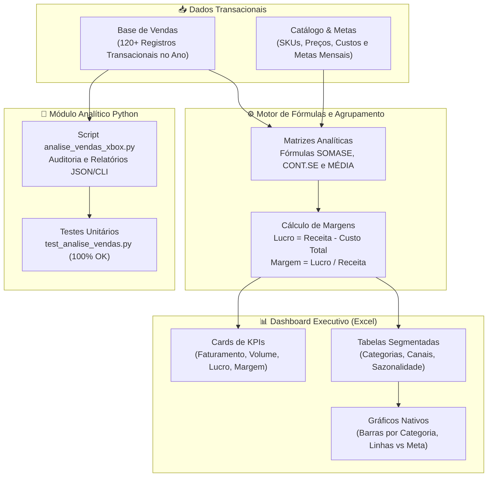

# 🎮 Dashboard Executivo de Vendas Xbox no Excel


Solução executiva completa de **Business Intelligence e Visualização de Dados** desenvolvida em **Microsoft Excel** com suporte a análises automatizadas em **Python**. O projeto consolida registros transacionais de vendas do ecossistema Xbox (hardware, periféricos, softwares e assinaturas), transformando dados brutos em indicadores-chave de performance (KPIs), margens financeiras e gráficos para suporte à tomada de decisão.

---

## 🎯 Objetivos do Projeto

- **Organização e Modelagem Contábil**: Estruturação de dados transacionais limpos, categorizados e parametrizados em planilha Excel profissional.
- **Visualização Executiva**: Painel dinâmico (Dashboard) contendo cartões de KPIs em tempo real, matrizes comparativas e gráficos nativos embutidos.
- **Análise Multidimensional**: Avaliação de resultados segmentada por:
  - **Categorias**: Consoles, Jogos, Acessórios e Serviços (Xbox Game Pass).
  - **Canais de Distribuição**: Microsoft Store Oficial, Varejo Físico e E-commerce Parceiro.
  - **Sazonalidade**: Desempenho mensal e atingimento de metas comerciais ao longo de 12 meses.
  - **Rentabilidade**: Apuração de Faturamento Bruto, Custos de Mercadorias Vendidas (CMV), Lucro Bruto e Margem de Contribuição (%).
- **Auditoria Analítica via Python**: Módulo em script CLI para extração de métricas, conferência cruzada e relatórios em JSON.

---

## 🏗️ Arquitetura e Fluxo de Dados



---

## 📑 Estrutura da Pasta de Trabalho Excel

O arquivo **[`Dashboard_Vendas_Xbox.xlsx`](./Dashboard_Vendas_Xbox.xlsx)** está estruturado em 4 abas interconectadas:

| Aba | Finalidade | Recursos e Fórmulas Principais |
| :--- | :--- | :--- |
| **`Dashboard Executivo`** | Painel principal de tomada de decisão com paleta de cores oficial Xbox, botões de navegação rápida, 4 cartões de KPIs principais, tabelas consolidadas e gráficos nativos embutidos. | Cartões vinculados à matriz analítica, gráficos nativos de colunas e linhas, formatação condicional executiva. |
| **`Base_Vendas`** | Tabela transacional com histórico anual de pedidos, contendo ID, data, região, canal, categoria, produto, quantidade, preço unitário, receita bruta, custo unitário e lucro bruto. | Fórmulas automáticas de faturamento (`=Qtd*Preço`), custos (`=Qtd*Custo`) e margens (`=Lucro/Receita`). |
| **`Matrizes_Analiticas`** | Tabelas de suporte com agrupamentos dinâmicos que alimentam o Dashboard sem poluir os dados brutos. | Fórmulas `=SOMASE()`, `=CONT.SE()` e `=MÉDIA()`. |
| **`Metas_Catalogo`** | Parâmetros de metas de receita mês a mês (Jan a Dez) e catálogo oficial de produtos/SKUs. | Metas comerciais anuais e taxas de conversão de canal. |

---

## 🧮 Indicadores Chave de Desempenho (KPIs)

- **Faturamento Bruto Total**: R$ 341.535,00
- **Total de Unidades Vendidas**: 475 unidades
- **Lucro Bruto Consolidado**: R$ 138.360,00
- **Margem Bruta Média**: 40,51%
- **Ticket Médio por Unidade**: R$ 719,02

### Desempenho por Categoria
1. **Consoles**: Maior representatividade em receita bruta (~39,25%), puxado pelo Xbox Series X e Xbox Series S.
2. **Acessórios**: Segunda maior força comercial (~38,42%), impulsionado pelo Cartão de Expansão Seagate 1TB e Controles Sem Fio.
3. **Jogos**: Alta margem de rentabilidade (71,57% de margem média).
4. **Serviços**: Alta recorrência e sustentação de caixa com Xbox Game Pass Ultimate.

---

## 💻 Script de Análise e Auditoria em Python

Para garantir conformidade de auditoria e permitir pipelines automatizados, o projeto inclui o utilitário **`analise_vendas_xbox.py`**:

### Execução via Terminal
```bash
python analise_vendas_xbox.py
```

### Exemplo de Saída
```text
================================================================================
DASHBOARD EXECUTIVO DE VENDAS XBOX - RELATORIO ANALITICO
Autor: Wendel Vieira | Status: Consolidado
================================================================================
Faturamento Bruto Total : R$ 341.535,00
Unidades Totais Vendidas: 475 unidades
Lucro Bruto Consolidado : R$ 138.360,00
Margem Bruta Media      : 40.51 %
Ticket Medio por Unidade: R$ 719,02
--------------------------------------------------------------------------------
DESEMPENHO POR CATEGORIA:
Categoria       | Faturamento      | Unidades   | Lucro            | Margem   | Share   
--------------------------------------------------------------------------------
Jogos           | R$ 52.384,00     | 176        | R$ 37.489,00     | 71.57 %  | 15.34 % 
Consoles        | R$ 134.058,00    | 42         | R$ 35.508,00     | 26.49 %  | 39.25 % 
Servicos        | R$ 23.891,00     | 109        | R$ 16.641,00     | 69.65 %  | 7.0 %   
Acessorios      | R$ 131.202,00    | 148        | R$ 48.722,00     | 37.14 %  | 38.42 % 
--------------------------------------------------------------------------------
DESEMPENHO POR CANAL DE DISTRIBUICAO:
 - Varejo Fisico Especializado   : R$ 129.059,00    (37.79 % do total)
 - Microsoft Store Oficial       : R$ 114.581,00    (33.55 % do total)
 - E-commerce Parceiro           : R$ 97.895,00     (28.66 % do total)
--------------------------------------------------------------------------------
TOP 5 PRODUTOS MAIS VENDIDOS:
 1. Cartao Expansao Seagate 1TB            | Receita: R$ 82.445,00 | Margem: 34.62 %
 2. Xbox Series S 512GB                    | Receita: R$ 64.776,00 | Margem: 27.75 %
 3. Xbox Series X 1TB                      | Receita: R$ 40.491,00 | Margem: 24.43 %
 4. Xbox Series S 1TB Carbon Black         | Receita: R$ 28.791,00 | Margem: 26.54 %
 5. Controle Sem Fio Xbox Robot White      | Receita: R$ 17.062,00 | Margem: 42.09 %
================================================================================
```

### Saída Estruturada em JSON
```bash
python analise_vendas_xbox.py --json
```

---

## 🧪 Testes Unitários

O projeto conta com suíte de testes com `unittest` para validação da consistência dos dados da planilha:

```bash
python -m unittest test_analise_vendas.py
```

```text
.....
----------------------------------------------------------------------
Ran 5 tests in 0.221s

OK
```

---

## 👤 Autor

Desenvolvido por **Wendel Vieira**.  
Desafio de Projeto DIO & Reclame AQUI: *Criando um Dashboard de Vendas do Xbox com Excel*.
